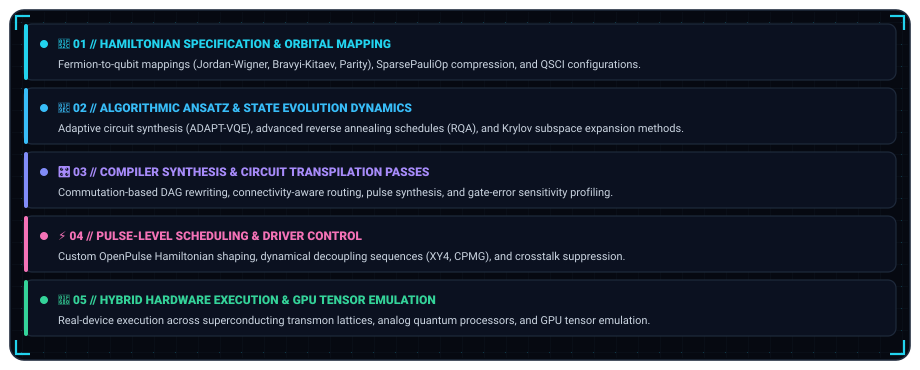
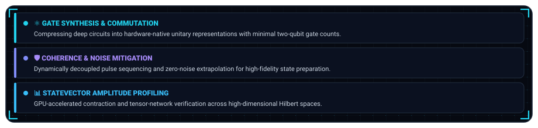
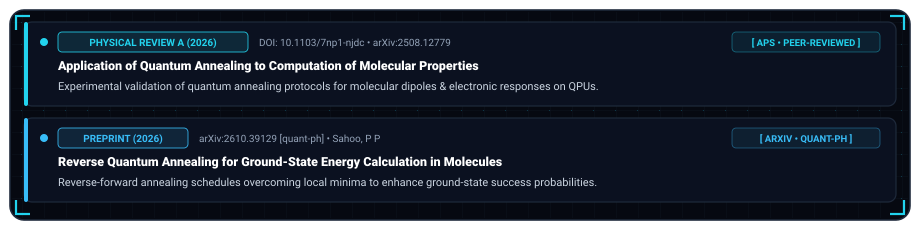

  <!-- Animated Futuristic Cyber Header -->
  

    

  <!-- Animated Cyber Typing Subtitle -->
  

   

  <!-- Cyber Telemetry Status Badges -->
  
  &nbsp;
  
  &nbsp;
  
  &nbsp;
  

    

  <!-- Uplink Channels -->
  
  &nbsp;
  
  &nbsp;
  
  &nbsp;
  

 

<!-- Animated Quantum Kernel Telemetry Console -->

  

---

## ⚡ // 01. AUTOMATED QUANTUM EXECUTION PIPELINE

  
  
    
  <!-- Glowing Animated Execution Stack Telemetry Cards -->
  

---

## 🎛️ // 02. QUANTUM CIRCUIT SYNTHESIS & REAL-TIME TELEMETRY

  
  
    
  <!-- Glowing Animated Circuit Telemetry Cards -->
  

---

## 🌌 // 03. CORE SCIENTIFIC VECTORS & METHODOLOGIES

  
  

---

## 📚 // 04. SELECTED PUBLICATIONS & PREPRINTS

  
    
  <!-- Glowing Animated Publications HUD -->
  
    
  

---

## 💻 // 05. QUANTUM COMPUTE MATRIX & TECH STACK

  
   

### ⚛️ Quantum SDKs & Transpilation Frameworks
&nbsp;
&nbsp;
&nbsp;
&nbsp;
&nbsp;
&nbsp;

 

### 💻 High-Performance Computing & Accelerated Core
&nbsp;
&nbsp;
&nbsp;
&nbsp;

 

### 🧠 Scientific Computing & Numerical Frameworks
&nbsp;
&nbsp;
&nbsp;
&nbsp;

---

## 🛰️ // 06. LIVE TELEMETRY & ACTIVITY METRICS

  
  

 

  <!-- Live Auto-Updating Real-Time Contribution Activity Graph -->
  

    

  <!-- Live Auto-Updating Real-Time Streak Stats & GitHub Metrics -->
  
  &nbsp;
  

---

## 📡 // 07. SECURE TRANSMISSION & COMMS UPLINK

  

    

  
  &nbsp;
  
  &nbsp;
  
  &nbsp;
  

 

<!-- Animated Futuristic Cyber Footer -->

  

