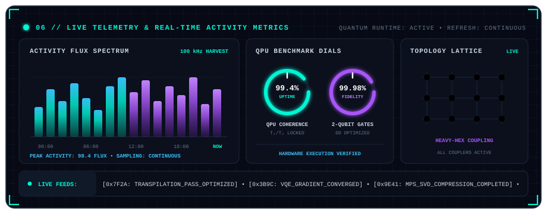
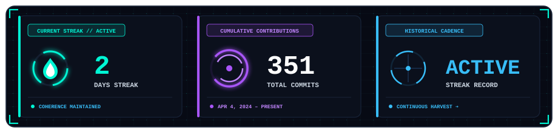

  <!-- Animated Futuristic Cyber Header -->
  

    

  <!-- Animated Cyber Typing Subtitle -->
  

   

  <!-- Cyber Telemetry Status Badges -->
  
  
  
  

    

  <!-- Uplink Channels -->
  
  
  
  

 

<!-- Animated Quantum Kernel Telemetry Console -->

  

---

## ⚡ // 01. AUTOMATED QUANTUM EXECUTION PIPELINE

  
<em>Continuous Quantum Data Flow: From Problem Hamiltonian to Pulse-Level QPU Execution &amp; Tensor Verification</em>

  

 

* 🔬 **01 // Hamiltonian Mapping:** Fermion-to-qubit mappings (Jordan-Wigner, Bravyi-Kitaev, Parity), `SparsePauliOp` compression, and selected subspace configurations.
* 🧬 **02 // Algorithmic State Dynamics:** Adaptive circuit synthesis, advanced annealing schedules, and Krylov subspace expansion methods.
* 🎛️ **03 // Transpiler Optimization Passes:** Commutation-based DAG rewriting, connectivity-aware routing, pulse synthesis, and gate-error sensitivity profiling.
* ⚡ **04 // Pulse-Level Control:** Custom OpenPulse Hamiltonian shaping, dynamical decoupling (DD), and crosstalk suppression.
* 🚀 **05 // Hybrid Hardware & HPC Backends:** Real-device execution across superconducting transmon lattices, analog quantum processors, and GPU tensor emulation.

---

## 🎛️ // 02. QUANTUM CIRCUIT SYNTHESIS & REAL-TIME TELEMETRY

  
<em>Multi-Qubit Entanglement Substrate, Transpilation Passes &amp; Amplitude Telemetry</em>

  

 

* ⚛️ **Gate Synthesis & Commutation:** Compressing deep circuits into hardware-native unitary representations with minimal two-qubit gate counts.
* 🛡️ **Coherence & Noise Mitigation:** Dynamically decoupled pulse sequencing and zero-noise extrapolation for high-fidelity state preparation.
* 📊 **Statevector Amplitude Profiling:** GPU-accelerated contraction and tensor-network verification across high-dimensional Hilbert spaces.

---

## 🌌 // 03. CORE SCIENTIFIC VECTORS & METHODOLOGIES

  

---

## 📚 // 04. SELECTED PUBLICATIONS & PREPRINTS

* 📄 **Physical Review A (American Physical Society, 2026)**  
  **Application of Quantum Annealing to Computation of Molecular Properties**  
  *Pradyot Pritam Sahoo, et al.*  
  [DOI: 10.1103/7np1-njdc](https://journals.aps.org/pra/abstract/10.1103/7np1-njdc) &bull; [arXiv:2508.12779 [quant-ph]](https://arxiv.org/abs/2508.12779)  
  *Formulation and experimental validation of quantum annealing protocols for permanent dipole moments and response properties on adiabatic quantum processors.*

* 📄 **Preprint (2026)**  
  **Reverse Quantum Annealing for Ground-State Energy Calculation in Molecules**  
  *Pradyot Pritam Sahoo, et al.*  
  [arXiv:2610.39129 [quant-ph]](https://arxiv.org/abs/2610.39129) &bull; [PDF Download](https://arxiv.org/pdf/2610.39129)  
  *Investigating reverse-forward schedules to enhance ground-state success probabilities across strong electronic correlation regimes.*

   
  

---

## 💻 // 05. QUANTUM COMPUTE MATRIX & TECH STACK

### ⚛️ Quantum SDKs & Transpilation Frameworks

 

### 💻 High-Performance Computing & Accelerated Core

 

### 🧠 Scientific Computing & Numerical Frameworks

---

## 🛰️ // 06. LIVE TELEMETRY & ACTIVITY METRICS

  
<em>Continuous Kernel Telemetry: Hardware Activity Flux, Real-Time Fidelity Dials &amp; Dynamic Compute Grid</em>

  

 

  <!-- Animated Historical Contribution Graph -->
  

    

  <!-- Animated GitHub Streak & Cadence HUD -->
  

---

## 📡 // 07. SECURE TRANSMISSION & COMMS UPLINK

  
Open for research collaborations in quantum algorithms, pulse-level compilation, and GPU-accelerated simulation.

  
  &nbsp;
  
  &nbsp;
  

 

<!-- Animated Futuristic Cyber Footer -->

  

